# Abide

**A daily Bible reading companion for church leaders in Cebu, Philippines.**

Leaders do **RRR** (Read, Reflect, Respond) in a paper notebook, then check in on the app. Overseers see who has read today and can encourage those who haven't. The tone is always encouraging, never shaming.

- 👥 Built for about 100 leaders and their overseers
- 📱 Android first (Expo / React Native)
- 💸 Runs entirely on free plans: $0 to operate
- 🔒 Private by design: notebook photos never leave the phone, and leaders only see their own data

---

## Status

**Phases 2 and 3 of 9 (accounts and daily check-ins): code complete, being tested on a phone.**

```
Overall  ██████░░░░░░░░░░░░░░  ~30%
```



```mermaid
flowchart LR
  P1["1 · Setup"]:::done --> P2["2 · Sign-in"]:::wip --> P3["3 · Check-in"]:::wip --> P4["4 · Bible reader"]:::todo --> P5["5 · Notebook scan"]:::todo
  P5 --> P6["6 · Overseer view + streaks"]:::todo --> P7["7 · Badges & Heroes"]:::todo --> P8["8 · Pilot"]:::todo --> P9["9 · Chat"]:::todo

  classDef done fill:#2F5D50,stroke:#2F5D50,color:#FFFFFF
  classDef wip fill:#E9A23B,stroke:#E9A23B,color:#1F2A26
  classDef todo fill:#FAF7F2,stroke:#C9C1B4,color:#5E6B66
```

| | Phase | What it delivers | Status |
|---|---|---|---|
| 1 | **Setup** | Runs on a phone, Supabase connected, theme, tab layout | ✅ Done |
| 2 | **Sign-in & roles** | Accounts, profiles, small groups with join codes, leader/overseer/admin roles | 🟡 Testing |
| 3 | **Check-in** | Simple mode, then guided Read → Reflect → Respond screens | 🟡 Testing |
| 4 | **Bible reader** | Read Scripture in the app, version picker, highlights | ⬜ Planned |
| 5 | **Notebook scan** | Snap your notebook page; on-device text recognition fills in your check-in | ⬜ Planned |
| 6 | **Overseer view & streaks** | "Who read today" for overseers; streaks with a weekly grace day | ⬜ Planned |
| 7 | **Gamification** | Badges and *My Bible Heroes* | ⬜ Planned |
| 8 | **Pilot** | Daily reminders, backups, Android APK for 5–10 leaders | ⬜ Planned |
| 9 | **Chat** | 1:1 leader–overseer and cell-group chats | ⬜ After launch |

### Phase 2 progress

- [x] Database: `profiles`, `groups` and `group_members` tables, with Row Level Security
- [x] Open sign-up; a new account only sees its own data until it joins a group
- [x] Sign-in / sign-up screens; the app remembers who's signed in
- [x] Separate tabs for overseers (Today, Leaders) and leaders (Home, Heroes)
- [x] Overseers create small groups (cell groups or ministries) and share each group's join code
- [x] Leaders join one or more groups with a code from Profile; their group's overseer can then see them
- [ ] Tested end-to-end on an Android phone

### Phase 3 progress

- [x] `checkins` table: one per leader per day, today or yesterday only (Philippine time), enforced by the database
- [x] Simple mode: one tap on Home, with an optional passage
- [x] Guided mode: Read → Reflect → Respond steps with notebook reminders
- [x] Check in for yesterday if you forgot
- [x] Celebration screen after each check-in
- [ ] Tested end-to-end on an Android phone

---

## Tech stack

| Area | Choice |
|---|---|
| App | [Expo](https://expo.dev) (React Native) + TypeScript, [Expo Router](https://docs.expo.dev/router/introduction/) |
| Backend | [Supabase](https://supabase.com): Postgres, Auth, Realtime, Edge Functions (free plan) |
| Text recognition | Google ML Kit, on-device |
| Scripture | [API.Bible](https://scripture.api.bible) (free, non-commercial) |

## Running it locally

1. Install dependencies:
   ```bash
   npm install
   ```
2. Copy `.env.example` to `.env.local` and fill in your Supabase project URL and **publishable** key.
3. Apply the database migrations to your Supabase project:
   ```bash
   npx supabase link --project-ref <your-project-ref>
   npx supabase db push
   ```
4. Start the app and scan the QR code with [Expo Go](https://expo.dev/go) on your Android phone:
   ```bash
   npx expo start
   ```

## Project layout

```
src/app/          Screens (file-based routes)
  (auth)/         Sign-in and sign-up
  (tabs)/         The signed-in tabs
src/components/   Reusable UI (Button, TextField, Screen, …)
src/constants/    Theme: colours, spacing, fonts
src/lib/          Supabase client and data functions
supabase/         Database migrations
```
